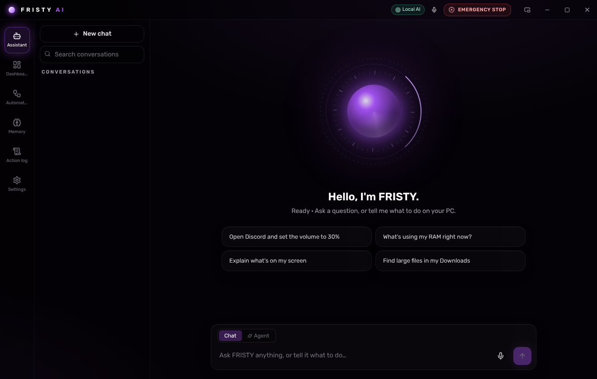
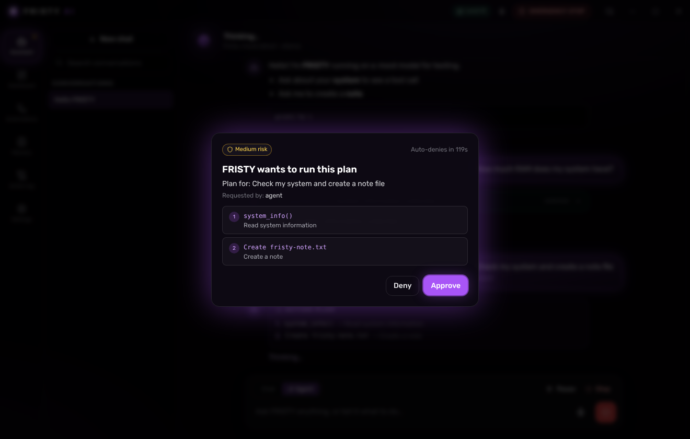
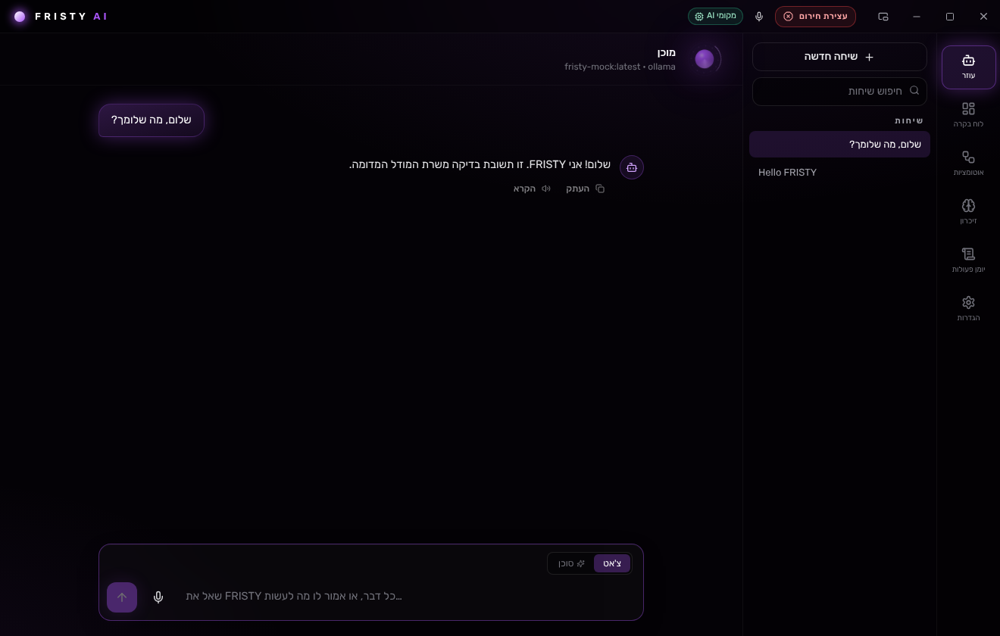
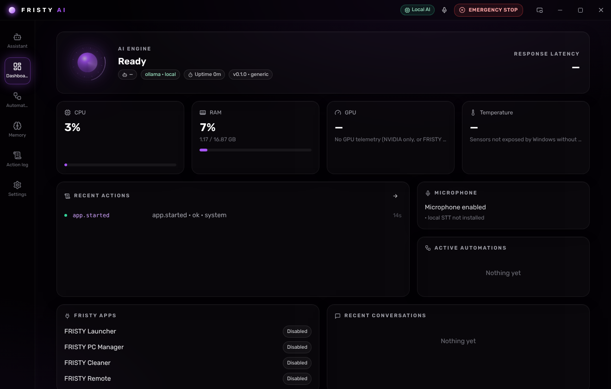
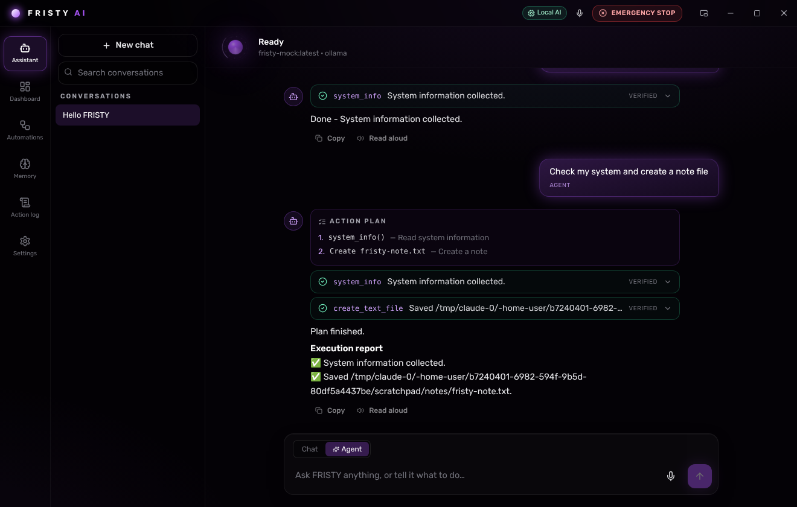
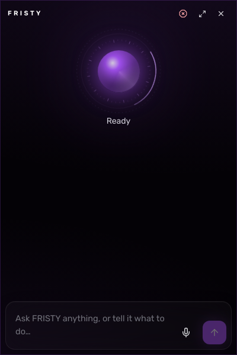

# FRISTY AI — Intelligent Desktop Assistant for Windows

FRISTY AI is a JARVIS-style personal assistant for Windows 10/11. It chats, listens, speaks, looks at your screen (only when you ask), and performs real actions on your PC — through a restricted, permission-checked and fully audited action engine.

- **AI**: local models through **Ollama**, or **OpenAI**, **Anthropic**, **Google Gemini** and any **OpenAI-compatible** endpoint (LM Studio, vLLM, OpenRouter…). Streaming, tool calling, model discovery, vision.
- **Voice**: push-to-talk, optional local wake word “Hey Fristy”, Hebrew + English speech recognition (local Whisper), Windows or OpenAI voices.
- **Computer control**: apps, games (Steam/Epic/Start Menu), websites, windows, volume, media, screenshots, lock/restart/shutdown, files, VS Code, terminal (with approval).
- **Screen understanding**: Windows UI Automation first, vision model as fallback; clicks and typing need your approval.
- **Agent mode**: plan → you approve → execute → verify → honest report, with pause/stop and hard limits.
- **Memory, automations** (“Gaming Mode”, “Good Night”…), **FRISTY app integrations**, **FRISTY Remote** pairing.
- **Security first**: 9 separate permissions (most off by default), confirmations for risky actions, emergency stop, audit log, OS credential storage for API keys, loopback-only token-protected backend.

---

## Install (end users)

1. Run **`FRISTY-AI-Setup-0.1.0-x64.exe`** (per-user install, no administrator rights needed).
   The installer is **not code-signed**, so Windows SmartScreen will warn: click *More info → Run anyway*.
2. Choose an AI provider in **Settings → AI**:
   - **Local (private, free):** install [Ollama](https://ollama.com/download), then in a terminal run `ollama pull qwen2.5:7b` (good tool use) or `ollama pull llama3.1`. For screen understanding add a vision model, e.g. `ollama pull gemma3`.
   - **Cloud:** paste an OpenAI / Anthropic / Gemini API key (stored in Windows Credential Manager, never in plain text).
3. Open **Settings → Permissions** and enable only what you want FRISTY to do. Add folders in **Settings → Files** to allow file actions.
4. Optional: **Settings → Voice**. The first voice command downloads the Whisper speech model (~460 MB for `small`) from huggingface.co once.

Uninstall from *Settings → Apps* or the Start Menu. Personal data (in `%APPDATA%\FRISTY AI`) is kept unless you tick “Personal data” in the uninstaller.

### Default shortcuts
| Action | Shortcut |
|---|---|
| Show / hide FRISTY | `Ctrl+Shift+F` |
| Push to talk | `Ctrl+Shift+Space` |
| Compact floating mode | `Ctrl+Shift+C` |
| **Emergency stop** (cancels everything, denies pending approvals, stops voice) | `Ctrl+Shift+F12` |
| Interrupt speech | `Esc` |

If another app already owns a shortcut, Settings → Startup & shortcuts shows it and lets you pick another. The red **Emergency stop** button in the title bar and the tray menu always work. PyAutoGUI's fail-safe (slam the mouse into a screen corner) also aborts mouse/keyboard automation.

## Hardware requirements

| | Minimum | Recommended |
|---|---|---|
| OS | Windows 10 64-bit (1903+) | Windows 11 |
| CPU | 4 cores x64 | 8 cores |
| RAM | 8 GB (cloud AI) | 16 GB+ for local 7–8B models; 32 GB for 14B+ |
| GPU | not required | NVIDIA 8 GB+ VRAM for fast local models / Whisper |
| Disk | 1.2 GB app | + 4–10 GB per local model, + 0.5–3 GB for Whisper models |
| Microphone | for voice features | |

FRISTY itself uses ~120–200 MB RAM idle (Electron UI + Python backend). The Whisper `small` model adds ~1 GB RAM while loaded; `tiny` (wake word) ~150 MB.

## Unsupported / limited features (read this)

- **Only Windows 10/11 is supported** for computer control. The backend runs on Linux/macOS for development, where Windows-only actions report “only supported on Windows” instead of pretending.
- **The Windows build has not been run on a real Windows PC by the author's build pipeline** (it was built and tested in a Linux CI environment). Windows-specific code (Win32/Core Audio/UI Automation) is implemented against the official APIs and unit-tested with a fake platform, but needs validation on real hardware — see `BUGS.md`.
- Temperatures: Windows does not expose CPU temperature without vendor drivers/admin rights. FRISTY shows NVIDIA GPU temperature (nvidia-smi), ACPI zones when available, or data from FRISTY PC Manager.
- FRISTY Launcher / PC Manager / Cleaner / Remote apps: FRISTY AI implements the **client side** of a documented local API (`docs/INTEGRATIONS.md`). Those apps must implement that contract; until then they show as “not connected”.
- FRISTY Remote LAN mode uses plain HTTP on your local network (paired-token authentication, no TLS). Keep it on trusted networks or loopback.
- Secure screens (UAC, lock screen, sign-in), password managers and password fields are never captured or typed into. Protected (DRM) content appears black in screenshots.
- The installer and app executable are unsigned and the app `.exe` uses the default Electron icon (setting the exe icon requires Wine/Windows at build time; the installer and shortcuts use the FRISTY icon).
- Wake-word detection is “local Whisper on short speech segments” — it works offline but uses some CPU while enabled and is less instant than a dedicated keyword-spotting model.

---

## Development

Requirements: Node 20+, Python 3.12+ (3.12 is what the installer bundles).

```bash
git clone <repo> fristy-ai && cd fristy-ai
python -m venv .venv
```

```bash
.venv/bin/pip install -r backend/requirements-dev.txt        # Windows: .venv\Scripts\pip
```

```bash
cd desktop && npm install && npm run dev
```

`npm run dev` starts Vite + Electron; Electron launches the backend from `.venv` automatically with a random port and token.

Run the backend alone (e.g. to use the UI in a browser at `http://127.0.0.1:5173/?port=8765&token=dev`):

```bash
cd backend && FRISTY_PORT=8765 FRISTY_TOKEN=dev ../.venv/bin/python -m fristy.main
```

### Testing without a real AI model
`tools/mock_ollama.py` is an Ollama-protocol-compatible scripted server used for UI and integration testing (it is not shipped):

```bash
.venv/bin/python tools/mock_ollama.py --port 11434
```

### Tests

```bash
.venv/bin/python -m pytest -q
```

```bash
cd desktop && npm test && npm run typecheck
```

### Build the Windows installer

```bash
bash scripts/build_installer.sh
```

This (1) downloads a standalone Windows CPython 3.12 and cross-installs all `win_amd64` wheels with `uv` (`scripts/build_windows_python.sh`), (2) builds the renderer and Electron bundles, (3) packages `win-unpacked` with electron-builder, (4) compiles `installer/fristy.nsi` with NSIS. Output: `desktop/release/FRISTY-AI-Setup-<version>-x64.exe`. Works on Linux (needs `makensis`) or Windows (Git Bash + NSIS).

## Project layout

```
backend/fristy/      Python backend (FastAPI)
  ai_engine/         providers (ollama, openai_compat, anthropic, gemini), manager, orchestrator, agent, prompts
  voice_engine/      Whisper STT, wake-phrase matching, cloud TTS
  computer_control/  action registry + restricted engine, confirmations, Windows/generic platform backends, input
  screen_analysis/   capture + privacy guard, UI Automation worker, OpenCV helpers
  files/  coding/    approved-folder sandbox, file ops, diffs/backups, restricted terminal
  memory/            personal memory + conversation store
  automations/       custom commands, triggers, conditions, scheduler
  integrations/      FRISTY Launcher / PC Manager / Cleaner clients, FRISTY Remote server
  security/          audit log, secrets (OS keyring), sanitizer, emergency stop
  api/               HTTP + WebSocket API
desktop/             Electron main/preload + React/TypeScript/Tailwind/Framer Motion UI
installer/           NSIS installer script
tests/backend/       pytest suite          docs/   architecture, security, integrations, testing
tools/               mock Ollama server, icon generator     scripts/  build scripts
```

The spec's module names map to `backend/fristy/<module>` (Python packages can't contain hyphens): `ai-engine → ai_engine`, `voice-engine → voice_engine`, etc.

See `ARCHITECTURE.md`, `docs/SECURITY.md`, `docs/INTEGRATIONS.md`, `docs/TESTING.md`, `TASKS.md`, `BUGS.md`, `NEXT_STEPS.md`.

## Screenshots

| Assistant | Agent approval | Hebrew (RTL) |
|---|---|---|
|  |  |  |
| **Dashboard** | **Agent report** | **Compact mode** |
|  |  |  |
